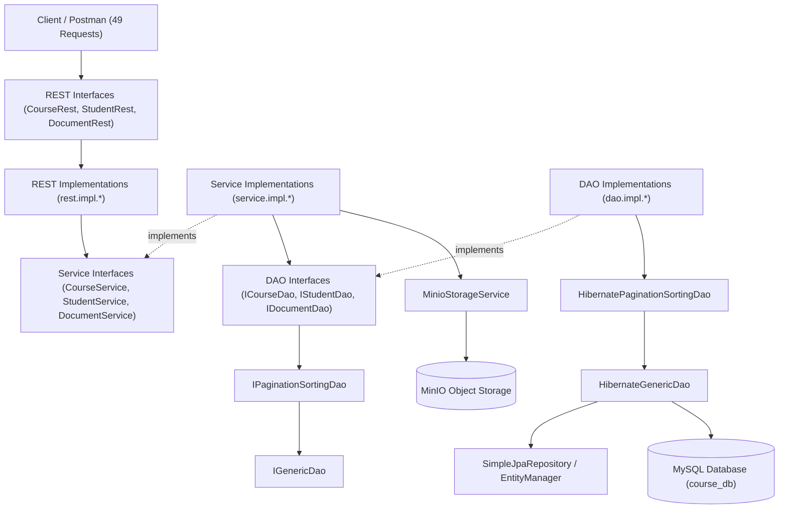

# Course Management System (CMS) - Master Engineering Standards & Workflows

Tài liệu này đóng gói toàn bộ quy chuẩn kỹ thuật, kiến trúc phân tầng, nguyên tắc thiết kế, logic nghiệp vụ, và workflow kiểm thử đã được thiết lập và chuẩn hóa cho dự án Course Management System.

---

## 1. Quick Reference: Các quy tắc vàng (Golden Rules)

| STT | Quy tắc cốt lõi | Chi tiết | Tài liệu tham khảo |
| :---: | :--- | :--- | :--- |
| **0** | **Pre-modification Confirmation & Git Backup** | **BẮT BUỘC:** Luôn nêu rõ chi tiết mọi thay đổi và hỏi lại người dùng trước khi bắt tay vào chỉnh sửa hoặc thêm mã nguồn trong dự án. Mọi thao tác sao lưu phiên bản, backup đều **BẮT BUỘC DÙNG GIT** (`git commit`, `git tag`, `git branch`), không copy thư mục `.backup` thủ công. | Quy định tương tác |
| **1** | **Strict 3-Layer Isolation** | Mọi tầng (`dao`, `service`, `rest`) đều có interface ở package gốc và class triển khai ở `.impl`. **Service CHỈ ĐƯỢC PHÉP gọi qua Interface DAO** (`ICourseDao`, `IStudentDao`, `IDocumentDao`). Tuyệt đối không tiêm `EntityManager`, `SimpleJpaRepository` hay `HibernateGenericDao` vào Service. | [01-architecture-rules.md](./references/01-architecture-rules.md) |
| **2** | **Hibernate DAO Hierarchy** | `IGenericDao` ➔ `IPaginationSortingDao` ➔ `[IEntityDao]`. Triển khai kế thừa: `HibernateGenericDao` ➔ `HibernatePaginationSortingDao` ➔ `[EntityDaoImpl]`. Tái sử dụng triệt để `buildSort`, `buildOrderClause`, `findByFieldPaged`, `findAllPaged`. | [02-dao-hibernate-hierarchy.md](./references/02-dao-hibernate-hierarchy.md) |
| **3** | **Document & MinIO Standards** | Lưu trữ nhị phân trên MinIO, lưu metadata trong MySQL (`APP_DETAIL_FK`). Bắt buộc kiểm tra định dạng whitelist, độ dài `<= 50`, không ký tự đặc biệt. Quản lý phiên bản tự động (`v + 1.0` khi trùng tên cùng `appId`, deactivate bản cũ). Xóa mềm (`deleted=true, active=false`). | [03-document-minio-service.md](./references/03-document-minio-service.md) |
| **4** | **JPA Specification Search** | Bộ phân tích cú pháp REST Query đa điều kiện (`:`, `>`, `<`, `>=`, `<=`, `!`) hỗ trợ tìm kiếm động phân trang và sắp xếp an toàn trên mọi thuộc tính Entity. | [04-jpa-specification-search.md](./references/04-jpa-specification-search.md) |
| **5** | **On-demand Testing Standard** | **CHỈ VIẾT / CẬP NHẬT TEST KHI CÓ YÊU CẦU:** Không tự động viết lại hoặc chạy test sau mỗi lần sửa code. Chỉ viết và cập nhật unit test khi người dùng yêu cầu rõ ràng. | [05-postman-and-testing-guide.md](./references/05-postman-and-testing-guide.md) |
| **6** | **Immediate & Complete Application** | **ÁP DỤNG NGAY TẠI NHỮNG CHỖ CẦN:** Mỗi khi bổ sung hoặc sửa đổi helper utility, converter, hàm kỹ thuật (như mã hóa AES, xử lý file, chuẩn hóa chuỗi...): Bắt buộc tích hợp và áp dụng ngay vào tất cả các API, Service, Entity liên quan đang cần, tuyệt đối không chỉ viết class riêng lẻ rồi để đấy. | Quy chuẩn phát triển |
| **7** | **No Autonomous Skill Modification** | **TUYỆT ĐỐI KHÔNG TỰ Ý SỬA SKILL / RULES:** Không được tự ý chỉnh sửa, bổ sung hoặc xóa bỏ bất kỳ nội dung, quy tắc nào trong thư mục skills (`.agents/skills/`) trừ khi có yêu cầu trực tiếp và rõ ràng từ người dùng. | Quy định tương tác |
| **8** | **Common Package Message Standardization** | **CHUẨN HÓA TOÀN BỘ THÔNG BÁO VÀO COMMON:** Mọi thông báo lỗi (Exception messages), thông báo nghiệp vụ, thông báo thành công (Success messages), chuỗi xác thực và phản hồi JSON **bắt buộc tập trung 100% tại package `common`** (`MessageConstants.java`, `ApiConstants.java`). Tuyệt đối cấm viết chuỗi hardcode phân tán trong Controller, Service, DAO. | Quy chuẩn phát triển |

---

## 2. Bản đồ kiến trúc hệ thống

---

## 3. Workflow phát triển tính năng mới (Step-by-Step)

Khi bổ sung một Entity hoặc Nghiệp vụ mới vào hệ thống, **bắt buộc tuân thủ đúng các bước sau**:

### Bước 0: Trình bày Kế hoạch & Chờ Người dùng Xác nhận (Bắt buộc)
1. Liệt kê rõ các file cần sửa, file cần tạo mới, nội dung chi tiết và lý do thay đổi.
2. Sao lưu an toàn bằng Git (`git commit` hoặc tạo branch/tag) trước khi chỉnh sửa mã nguồn.
3. Dừng lại, hỏi ý kiến và chờ người dùng xác nhận mới được phép thực thi.

### Bước 1: Khai báo Entity & Named Queries
1. Đặt trong `com.mkii.coursemanagementsystem.entity`.
2. Có index trên các trường tìm kiếm thường xuyên (`@Table(indexes = ...)`).
3. Sử dụng `@GenericGenerator` UUID nếu khóa chính là chuỗi, hoặc `@GeneratedValue(strategy = GenerationType.IDENTITY)` nếu là `Long`.
4. Viết sẵn `@NamedQuery` nếu có các truy vấn cố định quan trọng (như Document).

### Bước 2: Tầng DAO (Interface & Impl)
1. Tạo `I{Entity}Dao` kế thừa `IPaginationSortingDao<Pk, Entity>`.
2. Tạo `{Entity}DaoImpl` kế thừa `HibernatePaginationSortingDao<Pk, Entity>` và implement `I{Entity}Dao`.
3. Constructor gọi `super({Entity}.class, entityManager)`.
4. Tuyệt đối không viết lại các hàm phân trang, sắp xếp hay CRUD đã có ở lớp cha.

### Bước 3: Tầng Service (Interface & Impl)
1. Tạo `{Entity}Service` định nghĩa các nghiệp vụ.
2. Tạo `{Entity}ServiceImpl` implement `{Entity}Service`.
3. **Chỉ inject `I{Entity}Dao`** (Interface) thông qua Constructor Injection hoặc `@Autowired`.
4. Đảm bảo toàn bộ logic validation (định dạng, kích thước, trùng lặp, versioning) nằm tại Service.
5. **Áp dụng ngay các Utility/Helper liên quan:** Nếu có thêm mới hoặc sửa đổi utility (như mã hóa, kiểm tra file, xử lý chuỗi), tích hợp trực tiếp vào Service ngay lập tức, không để lại code không dùng.

### Bước 4: Tầng REST Controller (Interface & Impl)
1. Tạo `{Entity}Rest` interface khai báo tất cả endpoint, HTTP methods, `@RequestParam`, `@PathVariable`, `@RequestBody`.
2. Tạo `{Entity}RestImpl` implement `{Entity}Rest`, annotate `@RestController`, `@RequestMapping("/api/...")`, `@CrossOrigin`.
3. Bọc logic từng endpoint trong khối `try-catch`, ghi log bằng `logger.info(...)` và `logger.error(...)`, trả về `ResponseEntity<?>`.

### Bước 5: Cập nhật Postman & Viết Unit Test (Chỉ thực hiện khi có yêu cầu)
1. Thêm đầy đủ request vào file Postman collection `Course Management System - Full APIs.postman_collection.json`.
2. **Chỉ viết hoặc cập nhật Unit Test khi người dùng yêu cầu rõ ràng:** Không tự động sửa/chạy lại test sau mỗi lần sửa code.
3. Nếu người dùng yêu cầu kiểm thử, chạy xác nhận qua `mvnw test`.

---

## 4. Danh mục tài liệu chi tiết (Deep-dive References)

* **[Kiến trúc 3 tầng & Nguyên tắc cách ly](./references/01-architecture-rules.md)**: Quy tắc phân tầng, cấu trúc package, các điều cấm kỵ (anti-patterns).
* **[Hệ thống Generic Hibernate DAO](./references/02-dao-hibernate-hierarchy.md)**: Cây kế thừa DAO, phân trang, sắp xếp, chống SQL Injection với `isValidIdentifier`.
* **[Nghiệp vụ Document & MinIO Storage](./references/03-document-minio-service.md)**: Chuẩn lưu trữ MinIO, liên kết `APP_DETAIL_FK`, logic Versioning tự động, kiểm tra định dạng và xóa mềm.
* **[Cú pháp tìm kiếm JPA Specification](./references/04-jpa-specification-search.md)**: Quy chuẩn REST Query Language, toán tử so sánh, builder regex.
* **[Hướng dẫn Postman & Chạy kiểm thử](./references/05-postman-and-testing-guide.md)**: Danh mục 49 API, biến môi trường, thiết lập JDK 21+ và lệnh chạy.
