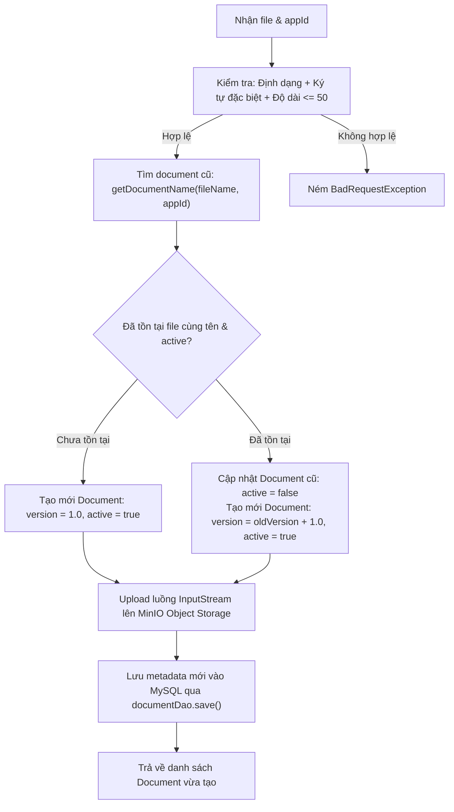

# Nghiệp vụ Document & MinIO Object Storage (Document & MinIO Specification)

Tài liệu này quy chuẩn toàn bộ logic nghiệp vụ quản lý tài liệu, tích hợp MinIO Object Storage, cơ sở dữ liệu quản lý metadata, quy tắc kiểm tra tính hợp lệ của file, cơ chế Versioning và phân trang tìm kiếm.

---

## 1. Mô hình lưu trữ kết hợp (Hybrid Storage Architecture)

Hệ thống quản lý tài liệu kết hợp 2 thành phần độc lập nhưng gắn kết chặt chẽ:
1. **MinIO Object Storage:** Chuyên lưu trữ file nhị phân (binary content). Đường dẫn lưu trữ quy định: `{appId}/{uuid}_{fileName}` hoặc `{appId}/{fileName}`.
2. **Cơ sở dữ liệu MySQL:** Chuyên quản lý metadata, trạng thái xóa mềm, phiên bản và khóa ngoại liên kết với nghiệp vụ hệ thống.

---

## 2. Cấu trúc Entity `Document`

Entity `Document` ánh xạ vào bảng `documents` trong cơ sở dữ liệu:

```java
@Entity
@Table(name = "documents", indexes = {
        @Index(name = "idx_doc_app_id", columnList = "APP_DETAIL_FK"),
        @Index(name = "idx_doc_name", columnList = "NAME"),
        @Index(name = "idx_doc_deleted", columnList = "DELETED"),
        @Index(name = "idx_doc_active", columnList = "ACTIVE")
})
@NamedQueries({
        @NamedQuery(name = "getDocumentByName", query = "SELECT d FROM Document d WHERE d.name = :name AND d.appId = :appId AND d.active = true AND d.deleted = false"),
        @NamedQuery(name = "getDocumentByAppId", query = "SELECT d FROM Document d WHERE d.appId = :appId AND d.active = true AND d.deleted = false")
})
public class Document {
    @Id
    @GeneratedValue(generator = "UUID")
    @GenericGenerator(name = "UUID", strategy = "org.hibernate.id.UUIDGenerator")
    @Column(name = "ID", updatable = false, nullable = false)
    private String id;

    @Column(name = "APP_DETAIL_FK", nullable = false)
    private String appId; // Foreign key chỉ ra document này thuộc công việc cụ thể nào

    @Column(name = "NAME", nullable = false)
    private String name;

    @Column(name = "PATH", nullable = false)
    private String path;

    @Column(name = "OWNER")
    private String owner;

    @Column(name = "VERSION")
    private Double version;

    @Column(name = "DELETED")
    private Boolean deleted;

    @Column(name = "ACTIVE")
    private Boolean active;

    @Column(name = "CREATED_TIME")
    private Date creationTime;

    @Column(name = "MODIFIED_TIME")
    private Date modificationTime;

    @PrePersist
    void onCreate() {
        this.creationTime = new Date();
        this.modificationTime = new Date();
        if (this.deleted == null) this.deleted = false;
        if (this.active == null) this.active = true;
    }

    @PreUpdate
    void onPersist() {
        this.modificationTime = new Date();
    }
}
```

---

## 3. Các quy chuẩn kiểm tra tính hợp lệ trước khi lưu (Pre-upload Validation)

Trước khi thực hiện upload file lên MinIO hoặc lưu vào DB, Service phải thực hiện các bước kiểm tra sau theo thứ tự:

### 1. Kiểm tra định dạng mở rộng (File Extension Whitelist)
* Danh sách định dạng cho phép: `PDF`, `XLSX`, `XLS`, `DOC`, `DOCX`, `JPG`, `JPEG`, `PNG`.
* So sánh không phân biệt hoa thường (`toLowerCase()`).
* Nếu định dạng không nằm trong danh sách cho phép, ném `BadRequestException("Định dạng file không được hỗ trợ...")`.

### 2. Kiểm tra độ dài tên file (Max Length <= 50)
* Tên file gốc (bao gồm cả phần mở rộng) không được vượt quá **50 ký tự**.
* Nếu vượt quá, ném `BadRequestException("Tên file không được vượt quá 50 ký tự...")`.

### 3. Kiểm tra ký tự đặc biệt (Special Characters Check)
* Tên file chỉ được chứa các ký tự an toàn: chữ cái (A-Z, a-z), chữ số (0-9), dấu chấm (`.`), dấu gạch dưới (`_`), dấu gạch ngang (`-`) và dấu khoảng trắng.
* Biểu thức Regex kiểm tra: `^[a-zA-Z0-9._ -]+$`
* Nếu vi phạm, ném `BadRequestException("Tên file chứa ký tự đặc biệt không hợp lệ...")`.

---

## 4. Cơ chế quản lý phiên bản tự động (Versioning Workflow)

Quy trình tạo tài liệu: `public List<Document> create(List<MultipartFile> files, String appId)`



---

## 5. Cơ chế Xóa mềm (Soft Delete)

Khi người dùng thực hiện xóa tài liệu (qua endpoint POST `/api/documents/delete` hoặc DELETE `/api/documents/{id}`):
* Tìm kiếm Document bằng `documentDao.findByPk(id)`.
* Nếu không tìm thấy, ném `ResourceNotFoundException`.
* Đánh dấu:
  * `document.setDeleted(true);`
  * `document.setActive(false);`
* Lưu lại: `documentDao.update(document);`
* File trên MinIO được giữ nguyên để phục vụ mục đích audit log hoặc khôi phục dữ liệu nếu cần.
* Trả về thông báo JSON thành công: `{"status":"SUCCESS","message":"Document deleted successfully"}`.

---

## 6. Phân trang và tìm kiếm tài liệu

Module Document hỗ trợ đầy đủ các API phân trang và tìm kiếm:
1. `GET /api/documents/search`: Tìm kiếm LIKE tên file, giới hạn `lowerLimit` (offset), `upperLimit` (size), sắp xếp `orderBy` & `orderType`, lọc theo `appId`.
2. `GET /api/documents/count`: Đếm tổng số lượng document thỏa mãn bộ lọc `query` và `appId`.
3. `GET /api/documents/paged`: Phân trang toàn bộ tài liệu qua `findAllPaged` của `HibernatePaginationSortingDao`.
4. `GET /api/documents/app/{appId}/paged`: Phân trang tài liệu theo từng công việc cụ thể qua `findByFieldPaged("appId", appId, ...)`.
5. `GET /api/documents/spec-search-paged`: Tìm kiếm dynamic JPA Specification đa điều kiện kết hợp phân trang.
