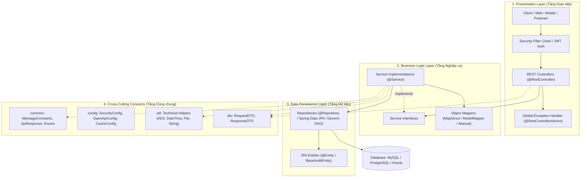

# Universal Spring Boot Project Standards & Architectural Playbook

Cẩm nang quy chuẩn kỹ thuật toàn diện dùng để thiết kế, cấu trúc, phát triển và chuẩn hóa **bất kỳ dự án Spring Boot nào** (Spring Boot 3.x / Java 17, 21+). Tài liệu này được chuẩn hóa theo định dạng mở, tương thích với **mọi AI Coding Agent** (Antigravity, Claude Code, Cursor, Copilot, Roo Code, Windsurf, Aider) và các kỹ sư phần mềm.

---

## 1. Bản đồ kiến trúc hệ thống tổng quát (Architecture Blueprint)



---

## 2. 10 Nguyên tắc vàng bất biến (The 10 Immutable Golden Rules)

Bất kỳ coding agent hoặc kỹ sư phần mềm nào khi tham gia phát triển dự án Spring Boot **bắt buộc phải tuân thủ nghiêm ngặt 10 nguyên tắc sau**:

| STT | Nguyên tắc | Chi tiết quy chuẩn | Tài liệu tham khảo |
| :---: | :--- | :--- | :--- |
| **1** | **Strict Layer Isolation & Interface-Driven** | Phân tầng rõ rệt: Controller ➔ Service ➔ Repository. Controller không được gọi trực tiếp Repository. Tầng Service phải có Interface định nghĩa hợp đồng nghiệp vụ và Class triển khai tại package `.impl`. | [01-package-structure-and-layering.md](./references/01-package-structure-and-layering.md) |
| **2** | **DTO & Entity Absolute Isolation** | **Tuyệt đối không để JPA Entity lọt ra ngoài Controller/Client.** Tầng REST chỉ giao tiếp qua Request/Response DTO. Mọi chuyển đổi DTO ⬌ Entity phải thực hiện qua Mapper rõ ràng. | [01-package-structure-and-layering.md](./references/01-package-structure-and-layering.md) |
| **3** | **Uniform API Response & RESTful Standard** | Mọi endpoint đều trả về cấu trúc chuẩn `ApiResponse<T>` (gồm `success`, `message`, `data`, `timestamp`). Sử dụng đúng động từ HTTP (`GET`, `POST`, `PUT`, `PATCH`, `DELETE`) và HTTP status codes chuẩn (200, 201, 204, 400, 401, 403, 404, 409, 500). | [02-rest-api-and-response-standards.md](./references/02-rest-api-and-response-standards.md) |
| **4** | **Centralized Messages & Error Handling** | **Không bao giờ viết chuỗi thông báo hardcode rải rác.** Toàn bộ thông báo lỗi, thông báo thành công, chuỗi validation bắt buộc khai báo tập trung trong `MessageConstants` hoặc `ErrorCode` enum đặt tại package `common`. Bắt lỗi tập trung bằng `@RestControllerAdvice`. | [03-exception-handling-and-messages.md](./references/03-exception-handling-and-messages.md) |
| **5** | **Constructor Injection (No Field Injection)** | **Tuyệt đối cấm dùng `@Autowired` trực tiếp trên thuộc tính (field injection).** Sử dụng Constructor Injection với thuộc tính `private final` (khuyên dùng Lombok `@RequiredArgsConstructor`). | [01-package-structure-and-layering.md](./references/01-package-structure-and-layering.md) |
| **6** | **Explicit Transaction Boundaries** | Mọi phương thức Service thực hiện ghi/sửa dữ liệu phải đánh dấu `@Transactional`. Các phương thức chỉ đọc dữ liệu bắt buộc dùng `@Transactional(readOnly = true)` để tối ưu Hibernate snapshot dirty checking và JDBC connection. | [04-persistence-data-jpa-standards.md](./references/04-persistence-data-jpa-standards.md) |
| **7** | **Zero N+1 Query & Safe Persistence** | Cấm truy vấn dữ liệu quan hệ vòng lặp dẫn đến N+1 queries. Luôn dùng `@EntityGraph`, `JOIN FETCH`, hoặc Projections. Tắt `open-in-view: false` (OSIV) trên môi trường production để bảo vệ connection pool. | [04-persistence-data-jpa-standards.md](./references/04-persistence-data-jpa-standards.md) |
| **8** | **Boundary Validation (Fail-Fast)** | Kiểm tra tính hợp lệ của dữ liệu ngay tại ranh giới Controller bằng Bean Validation (`@Valid`, `@Validated`, `@NotNull`, `@NotBlank`, `@Size`, etc.). Không để dữ liệu rác đi sâu vào tầng Service. | [02-rest-api-and-response-standards.md](./references/02-rest-api-and-response-standards.md) |
| **9** | **Externalized & Multi-Environment Config** | Không bao giờ lưu bí mật (mật khẩu DB, JWT secret, API key) trong code. Cấu hình tách biệt theo môi trường (`application-dev.yml`, `application-prod.yml`), đọc qua biến môi trường (`${DB_PASSWORD:...}`). | [05-security-and-configuration.md](./references/05-security-and-configuration.md) |
| **10** | **On-demand, Deterministic Testing** | Viết Unit Test và Integration Test độc lập, có thể tái lập kết quả bất kỳ lúc nào (dùng Mockito, H2/Testcontainers). Chỉ viết hoặc cập nhật test khi có yêu cầu rõ ràng từ người dùng. | [06-testing-and-quality-standards.md](./references/06-testing-and-quality-standards.md) |

---

## 3. Cấu trúc thư mục dự án chuẩn (Standard Package Layout)

### Mô hình 1: Package-by-Layer (Chuẩn hóa cho phần lớn dự án vừa và nhỏ)

```text
src/main/java/com/{company}/{project}/
├── Application.java                   # Class khởi chạy Spring Boot chính
├── common/                            # Tầng dùng chung toàn dự án
│   ├── ApiResponse.java               # Cấu trúc phản hồi API chuẩn
│   ├── PageResponse.java              # Cấu trúc phản hồi phân trang
│   ├── MessageConstants.java          # Toàn bộ hằng số thông báo hệ thống
│   ├── ApiConstants.java              # Hằng số đường dẫn, tiền tố API, regex
│   └── exception/                     # Ngoại lệ chung & Global Handler
│       ├── GlobalExceptionHandler.java
│       ├── AppException.java
│       ├── ResourceNotFoundException.java
│       └── BadRequestException.java
├── config/                            # Cấu hình Bean của Spring
│   ├── SecurityConfig.java            # Spring Security 6+ FilterChain
│   ├── OpenApiConfig.java             # Cấu hình Swagger / OpenAPI 3.0
│   ├── CorsConfig.java                # Cấu hình CORS
│   └── JpaAuditingConfig.java         # Tự động ghi nhận created_at, updated_at
├── controller/ (hoặc rest/)           # Tầng Giao tiếp REST API
│   ├── {Feature}Controller.java       # Interface định nghĩa endpoint
│   └── impl/
│       └── {Feature}ControllerImpl.java # Class triển khai Controller
├── dto/                               # Data Transfer Objects
│   ├── request/
│   │   ├── Create{Feature}Request.java
│   │   └── Update{Feature}Request.java
│   └── response/
│       └── {Feature}Response.java
├── entity/                            # Tầng JPA Entities (Database Mapping)
│   ├── BaseAuditEntity.java           # Lớp cha chứa id, created_at, updated_at, soft-delete
│   └── {Feature}.java
├── mapper/                            # Chuyển đổi DTO <-> Entity
│   └── {Feature}Mapper.java
├── repository/ (hoặc dao/)            # Tầng Lưu trữ & Truy vấn dữ liệu
│   ├── {Feature}Repository.java       # Kế thừa JpaRepository / JpaSpecificationExecutor
│   └── impl/                          # Custom Repository nếu cần HQL / Criteria
├── service/                           # Tầng Nghiệp vụ
│   ├── {Feature}Service.java          # Interface định nghĩa nghiệp vụ
│   └── impl/
│       └── {Feature}ServiceImpl.java  # Class triển khai nghiệp vụ
└── util/                              # Lớp tiện ích kỹ thuật tĩnh (Static Helpers)
    ├── AESUtil.java                   # Mã hóa / Giải mã kỹ thuật
    ├── DateTimeUtil.java              # Xử lý thời gian
    ├── FileUtil.java                  # Xử lý file / MIME type
    └── StringUtil.java                # Chuẩn hóa chuỗi ký tự
```

---

## 4. Workflow 6 bước phát triển Feature chuẩn cho Coding Agent

Khi được giao nhiệm vụ xây dựng một Feature hoặc Entity mới trong Spring Boot, Coding Agent **phải thực hiện tuần tự theo quy trình 6 bước**:

### Bước 1: Khai báo Entity & Indexing
- Kế thừa `BaseAuditEntity` để có sẵn `createdAt`, `updatedAt`, `createdBy`, `isDeleted`.
- Đánh chỉ mục (`@Table(indexes = ...)`) cho các trường thường xuyên `WHERE`, `JOIN`, `ORDER BY`.
- Thiết lập quan hệ `@ManyToOne`, `@OneToMany` có chiến lược `FetchType.LAZY`.

### Bước 2: Xây dựng Repository
- Tạo Interface kế thừa `JpaRepository<Entity, ID>` và `JpaSpecificationExecutor<Entity>`.
- Nếu có truy vấn tùy biến phức tạp, viết `@Query` với `JOIN FETCH` hoặc tạo interface custom repository.

### Bước 3: Định nghĩa DTOs & Validation
- Tạo `Create{Feature}Request`, `Update{Feature}Request` với đầy đủ annotation validation: `@NotBlank`, `@NotNull`, `@Size`, `@Email`.
- Tạo `{Feature}Response` chứa đúng dữ liệu cần hiển thị cho client (ẩn mật khẩu, token, khóa nhạy cảm).

### Bước 4: Xây dựng Tầng Service (Interface & Impl)
- Định nghĩa `{Feature}Service` Interface trước để tạo hợp đồng rõ ràng.
- Tạo `{Feature}ServiceImpl` đánh dấu `@Service`, inject Repository/Mapper qua `private final` và `@RequiredArgsConstructor`.
- Thêm `@Transactional(readOnly = true)` ở cấp độ class, và `@Transactional` tại các hàm sửa đổi dữ liệu.
- Mọi exception ném ra phải dùng các class ngoại lệ chuẩn và lấy thông báo từ `MessageConstants`.

### Bước 5: Xây dựng REST Controller
- Định nghĩa Interface Controller hoặc viết trực tiếp `@RestController` với `@RequestMapping("/api/v1/{resources}")`.
- Gắn annotation Swagger: `@Tag`, `@Operation`, `@ApiResponse`.
- Trả về `ResponseEntity<ApiResponse<T>>`.

### Bước 6: Kiểm thử (Chỉ khi có yêu cầu từ người dùng)
- Viết Unit Test cho Service dùng Mockito (`@ExtendWith(MockitoExtension.class)`).
- Viết WebMvc Test cho Controller (`@WebMvcTest`).
- Kiểm tra tính tương thích biên dịch bằng `./mvnw test-compile`.

---

## 5. Danh mục tài liệu chuyên sâu (Deep-dive References)

* **[01. Phân tầng kiến trúc & Package Layout](./references/01-package-structure-and-layering.md)**: Hướng dẫn Interface-Impl, Constructor Injection, DTO-Entity Isolation, Mappers.
* **[02. Chuẩn mực REST API & Response Wrapper](./references/02-rest-api-and-response-standards.md)**: HTTP Status codes, `ApiResponse<T>`, Phân trang `PageResponse<T>`, Validation boundary.
* **[03. Xử lý Ngoại lệ & Chuẩn hóa Thông báo](./references/03-exception-handling-and-messages.md)**: `@RestControllerAdvice`, Problem Details RFC 7807, `MessageConstants`, Error Codes.
* **[04. Chuẩn mực Dữ liệu & Spring Data JPA](./references/04-persistence-data-jpa-standards.md)**: Entity Auditing, Soft Delete, Tránh N+1 query, Dynamic Specification, Quản lý Transaction.
* **[05. Bảo mật & Quản lý Cấu hình](./references/05-security-and-configuration.md)**: Security 6 SecurityFilterChain, JWT Stateless, CORS, Profiles `application.yml`.
* **[06. Chuẩn mực Kiểm thử Tự động](./references/06-testing-and-quality-standards.md)**: Mockito, Slice Testing, AssertJ, Naming conventions.
* **[Mẫu Prompt ép chuẩn cho mọi Coding Agent](./resources/universal-agent-prompt.md)**: File prompt đa năng để gắn vào Cursor, Claude Code, Windsurf hoặc Copilot.
